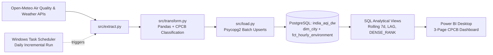
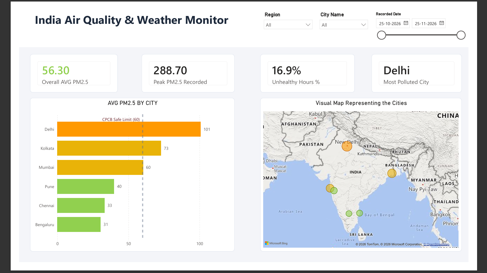
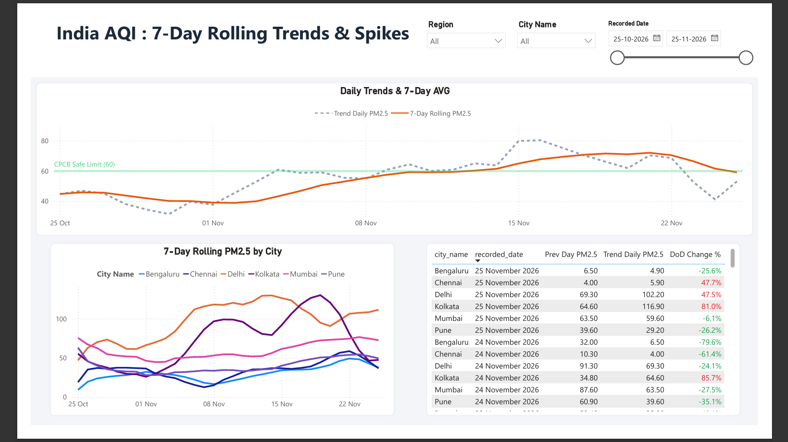
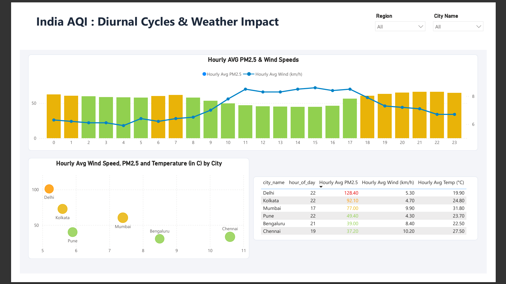

# India Air Quality & Weather ETL Pipeline

An automated, end-to-end data engineering and analytics pipeline that ingests hourly air quality (PM2.5, PM10, NO₂, European AQI) and weather metrics across 6 major Indian cities from the Open-Meteo APIs, transforms and classifies pollution severity under Indian **CPCB (Central Pollution Control Board)** standards, loads into a **PostgreSQL** star-schema warehouse, and powers a 3-page **Power BI** dashboard.

---

## Architecture



---

## Tech Stack

* **Extraction & Transformation:** Python, `requests`, `pandas`, `python-dotenv`
* **Data Warehouse & SQL Analytics:** PostgreSQL, `psycopg2` (`execute_values`), CTEs, Window Functions (`AVG OVER`, `LAG`, `DENSE_RANK`), Conditional Aggregation (`FILTER`)
* **Orchestration & Automation:** Modular Python orchestrator (`src/main.py`), dual file/stream logging, Windows Task Scheduler
* **BI & Visualisation:** Power BI Desktop, Star-Schema Modelling, DAX (`_Measures` table with dynamic CPCB hex colour formatting)

---

## Key Engineering Highlights

* **Actuals-Only Integrity:** Requests `forecast_days=1` to capture today's elapsed hours while slicing out future forecast timestamps in the transform layer so historical KPIs stay uncorrupted.
* **Idempotent Upserts:** Uses `ON CONFLICT (city_id, recorded_at) DO UPDATE` with `execute_values` batch inserts so re-runs and overlapping incremental loads (`past_days=2`) refresh revised sensor values with zero duplicates.
* **Fault Isolation & Observability:** Per-city `try/except` blocks paired with `conn.rollback()` prevent a single city's API or database error from halting the run, with full tracebacks and execution times persisted to `logs/pipeline.log`.
* **Warehouse-First Analytics:** Heavy aggregations, 7-day rolling averages, day-over-day % changes, and diurnal rankings live in PostgreSQL Views (`sql/02_analytical_views.sql`), keeping Power BI lightweight and reusable.

---

## Data Model & SQL Analytical Views

### Star Schema (`india_aqi_dw`)

* **`dim_city`**: City metadata (`city_id`, `city_name`, `state`, `region`, `latitude`, `longitude`).
* **`fct_hourly_environment`**: Hourly air quality and weather readings keyed on `(city_id, recorded_at)` with CPCB `aqi_category` labels and `ingested_at` audit timestamps.

### Analytical Views (`sql/02_analytical_views.sql`)

1. **`vw_daily_city_aqi`**: Daily rollups per city (`avg_pm2_5`, `max_pm2_5`, `avg_pm10`, weather averages) and CPCB unhealthy hour counts (`Poor`, `Very Poor`, `Severe`) via `COUNT(*) FILTER`.
2. **`vw_city_pollution_trends`**: 7-day rolling PM2.5 averages (`ROWS BETWEEN 6 PRECEDING AND CURRENT ROW`), prior-day baselines via `LAG()`, and zero-safe day-over-day % changes using `NULLIF()`.
3. **`vw_city_hourly_profile`**: 24-hour diurnal profiles (`hour_of_day` 0–23) with `DENSE_RANK()` identifying each city's peak pollution hour (`peak_hour_rank`) and cross-city rankings per hour (`city_rank_at_hour`).

---

## Power BI Dashboard

### Page 1: Executive Overview

*City-level PM2.5 severity against India's 60 µg/m³ 24-hour NAAQS safe limit, CPCB colour-coded KPIs, and geospatial bubble map.*


### Page 2: Rolling Trends & Spikes

*Raw daily PM2.5 vs. 7-day rolling averages, multi-city trend comparison, and ranked day-over-day pollution spikes.*


### Page 3: Diurnal & Weather Impact

*24-hour pollution vs. wind speed combo chart, wind-vs-PM2.5 scatter analysis, and peak pollution hours per city.*


---

## Project Structure

```text
india-aqi-etl-pipeline/
├── config/
│   └── cities.py                  # Target Indian city coordinates and metadata
├── docs/
│   └── images/                    # Power BI dashboard screenshots
├── powerbi/
│   └── india_aqi_dashboard.pbix   # 3-page Power BI report
├── sql/
│   ├── 01_create_schema.sql       # dim_city and fct_hourly_environment DDL
│   └── 02_analytical_views.sql    # 3 analytical PostgreSQL views
├── src/
│   ├── extract.py                 # Open-Meteo Air Quality & Weather API client
│   ├── transform.py               # Cleaning, actuals slicing, CPCB categorization
│   ├── load.py                    # Psycopg2 batch upserts and null handling
│   └── main.py                    # Pipeline orchestrator with fault isolation & logging
├── .env.example                   # Template for PostgreSQL credentials
├── .gitignore
├── requirements.txt
└── README.md
```

---

## Setup & Execution

1. **Clone the repository and create a virtual environment:**
   ```bash
   git clone [https://github.com/](https://github.com/)<your-username>/india-aqi-etl-pipeline.git
   cd india-aqi-etl-pipeline
   python -m venv venv
   .\venv\Scripts\activate
   pip install -r requirements.txt
   ```
2. **Configure environment variables:**
   Copy `.env.example` to `.env` and fill in your local PostgreSQL credentials (`DB_HOST`, `DB_PORT`, `DB_NAME`, `DB_USER`, `DB_PASSWORD`).
3. **Initialise PostgreSQL schema & views:**
   Create the `india_aqi_dw` database, then run `sql/01_create_schema.sql` and `sql/02_analytical_views.sql` in pgAdmin 4 or `psql`.
4. **Run the pipeline:**
   ```bash
   python -m src.main
   ```
5. **Schedule daily refreshes (Windows):**
   Configure Windows Task Scheduler to execute `venv\Scripts\python.exe` with arguments `-m src.main` and **Start in** set to the project root, with `run_pipeline(past_days=2)` for incremental daily loads.
